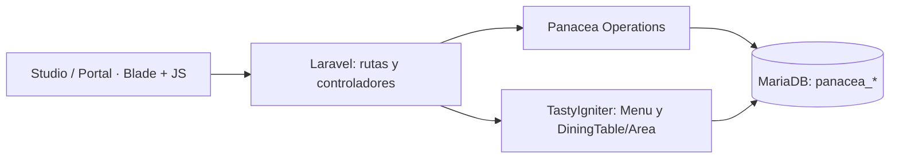

<div align="center">

# ✳ Panacea Restaurant

### Hospitality Tech · Operación gastronómica · Experiencia del cliente

**Plataforma de gestión para restaurantes sobre TastyIgniter 4.x**, con panel operativo, reservas, salón, comandas, cocina, caja manual, inventario, gerencia y experiencia pública de demostración.

[Documentación completa](docs/README.md) · [Arquitectura](docs/02_ARQUITECTURA_Y_STACK.md) · [Requisitos](docs/03_REQUISITOS_Y_REGLAS.md) · [Casos de uso](docs/04_CASOS_DE_USO.md) · [Instalación](docs/07_INSTALACION_Y_OPERACION.md)

</div>

> [!IMPORTANT]
> **Estado al 26 de octubre de 2026: desarrollo/MVP local.** No es un POS certificado ni una instalación preparada para producción. Las escrituras de Panacea viven principalmente en tablas propias y **no están todavía sincronizadas con el ciclo de vida completo de pedidos, reservas, pagos o stock nativos de TastyIgniter**. Sin autenticación/autorización efectiva por empleado ni integración fiscal/bancaria, **no publicar estos endpoints**.

> [!NOTE]
> **Nueva dirección arquitectónica:** el próximo Panacea Core será **independiente de TastyIgniter**. Este repositorio se conserva para demostrar y extraer las funcionalidades propias; **todavía está basado en TastyIgniter**. No se ha eliminado ninguna dependencia del ejecutable. Consulta la [auditoría de independencia](docs/architecture/AUDITORIA_INDEPENDENCIA.md), el [inventario de 145 archivos](docs/architecture/INVENTARIO_INDEPENDENCIA.csv) y el [plan de migración](docs/architecture/PLAN_MIGRACION_CORE.md).

## ¿Qué es Panacea Restaurant?

Panacea Restaurant busca reunir en un espacio el recorrido del negocio:

**Cliente solicita mesa → Recepción confirma → Salón abre servicio → Toma comanda → Cocina prepara/entrega → Caja registra abono → Gerencia revisa la operación.**

Ofrece una experiencia visual orientada a la hospitalidad: panel con modo claro/oscuro, verde bosque y superficies glass, barra lateral plegable, catálogo fotográfico, plano 2D de mesas y guía audiovisual interactiva **Presenter Quest** para presentar la demostración.

### Capacidades y madurez

| Módulo | Disponible en la rama | Límite actual |
| --- | --- | --- |
| **Inicio** | KPIs, actividad, reglas de alerta | Datos reales Panacea / modo Demo |
| **Reservas** | Solicitudes cliente `pending`, confirmación y cancelación | No sincronización nativa completa |
| **Salón** | Áreas/mesas nativas, plano 2D editable, servicios | Ocupación nativa todavía no consolidada |
| **Pedidos y KDS** | Comandas Panacea y estados de cocina | No persisten en `orders` nativas |
| **Caja** | Abonos manuales, saldo y cierre | Sin pasarela, conciliación bancaria o factura fiscal |
| **Catálogo** | Productos, precios e imágenes de TastyIgniter | Imágenes ilustrativas etiquetadas si faltan fotos |
| **Inventario** | Ingredientes, entradas, recetas y consumo | Stock propio de Panacea, no stock contable nativo |
| **Clientes/personal** | Perfiles, visitas, turnos e incidencias | Sin permisos efectivos por actor |
| **Gerencia** | Indicadores, auditoría básica y alertas explicables | No IA generativa ni contabilidad completa |
| **Cliente** | Página `/experiencia`, menú y solicitud de reserva | Portal solo local y confirmación posterior |
| **Demo guiada** | Ruta exprés/completa con spotlight | Sin operaciones reales; datos ficticios |

## Stack técnico

| Capa | Tecnología |
| --- | --- |
| Lenguaje y framework | **PHP 8.3**, **Laravel 13** |
| Base del restaurante | **TastyIgniter 4.x**, `tastyigniter/core ^4.4` |
| Persistencia | **MariaDB 11.4** |
| Servidor de desarrollo | **Apache** en Docker (`php:8.3-apache`) |
| Frontend Panacea | **Blade, HTML5, CSS3, JavaScript vanilla, SVG** |
| Gestores/build | **Composer 2**, npm / Laravel Mix en proyecto base |
| Calidad | **PHPUnit 12**, **Node.js smoke tests**, **GitHub Actions** |

No se ha añadido un framework SPA como React o Vue al panel Panacea.

## Inicio rápido (local)

Necesitas **Git, Docker Desktop y Docker Compose v2**; puerto `127.0.0.1:8088` disponible y dependencias descargables.

```bat
git clone https://github.com/90oso/Panacea-Rest-.git
cd Panacea-Rest-
git switch feat/panacea-restaurant-mvp
docker compose -f compose.panacea.yml up -d --build
docker compose -f compose.panacea.yml exec app composer install
```

Si no existe, crear un `.env` a partir de `.env.example`, definir `APP_ENV=local`, `APP_URL=http://localhost:8088`, `DB_HOST=db` y credenciales que coincidan con **el contenedor de desarrollo**. Generar `APP_KEY` si falta. **Instalar/configurar TastyIgniter según su versión antes de aplicar migraciones de Panacea.** Para una instalación ya configurada:

```bat
docker compose -f compose.panacea.yml exec app php artisan migrate:status
docker compose -f compose.panacea.yml exec app php artisan migrate
docker compose -f compose.panacea.yml exec app php artisan optimize:clear
```

Más detalles y solución de problemas: [Instalación y runbook](docs/07_INSTALACION_Y_OPERACION.md). No copiar contraseñas de Docker a producción ni subir `.env`.

### Páginas locales

| Página | Dirección |
| --- | --- |
| **Operations Studio** | [localhost:8088/panacea-preview](http://localhost:8088/panacea-preview) |
| **Portal cliente** | [localhost:8088/experiencia](http://localhost:8088/experiencia) |
| **Diagnóstico local** | [localhost:8088/panacea-preview/health](http://localhost:8088/panacea-preview/health) |
| **Admin TastyIgniter** | [localhost:8088/admin](http://localhost:8088/admin) |

Estos enlaces apuntan al **Docker del equipo que ejecuta el proyecto**, no a un servidor público.

## Arquitectura resumida



El editor de plano actualiza propiedades/posiciones nativas de mesa y elementos del plano Panacea. La mayoría de las operaciones de reserva, servicio, comanda, inventario y abono usan tablas propias `panacea_*`. Los contratos nativos completos quedan en el roadmap.

## Documentación del proyecto

| Documento | Propósito |
| --- | --- |
| [Índice de documentación](docs/README.md) | Estado, criterios y organización |
| [01 · Visión y alcance](docs/01_VISION_Y_ALCANCE.md) | Problema, objetivo, actores, módulos |
| [02 · Arquitectura y stack](docs/02_ARQUITECTURA_Y_STACK.md) | Componentes, dependencias y diagramas |
| [03 · Requisitos](docs/03_REQUISITOS_Y_REGLAS.md) | RF, RNF, prioridades, reglas y criterios |
| [04 · Casos de uso](docs/04_CASOS_DE_USO.md) | Actores, precondiciones, flujos y errores |
| [05 · Modelo de datos](docs/05_MODELO_DE_DATOS.md) | Entidades, relaciones y estado |
| [06 · API y procesos](docs/06_API_Y_FLUJOS.md) | Rutas, payloads, validaciones y respuestas |
| [07 · Instalación](docs/07_INSTALACION_Y_OPERACION.md) | Docker, diagnóstico y operación |
| [08 · Calidad y riesgos](docs/08_CALIDAD_SEGURIDAD_Y_RIESGOS.md) | Pruebas, límites de seguridad, riesgos |
| [09 · Hoja de ruta](docs/09_HOJA_DE_RUTA.md) | Integración nativa y condiciones de cierre |
| [10 · Guía de usuario](docs/10_GUIA_DE_USUARIO.md) | Uso diario, Demo/Real y grabación |

El archivo anterior [PANACEA_PRODUCT_SCOPE.md](docs/PANACEA_PRODUCT_SCOPE.md) es **histórico y está parcialmente obsoleto**; consultar los documentos fechados para el estado actual.

## Demostración / Presenter Quest

1. Abrir `/panacea-preview`.
2. Pulsar el **pequeño ✳** en la barra superior.
3. Escoger **Ruta exprés** o **Recorrido completo**.
4. Avanzar con `←`/`→`, usar `▶` para avance automático cada 9 s y `Esc` para salir.

Al iniciar el recorrido se utiliza **Demostración** y se evita ejecutar mutaciones operativas. Más detalles: [Presenter Quest](docs/PANACEA_PRESENTER_QUEST.md).

## Verificaciones

```bat
node tests/panacea-studio-dom-smoke.mjs
node tests/panacea-studio-shell-smoke.mjs
node tests/panacea-guest-smoke.mjs
node tests/panacea-presenter-quest-smoke.mjs
```

GitHub Actions ejecuta lint de PHP/JS y pruebas de humo. **No sustituyen** pruebas de integración MariaDB, cargas concurrentes, seguridad ni aceptación con navegador real.

## Seguridad y producción

Las rutas de desarrollo verifican `APP_ENV=local`, pero esta restricción **no es autenticación de usuarios**. Antes de usar Panacea con operaciones reales faltan RBAC/ABAC, auditoría atribuible, sincronización TastyIgniter, privacidad, cumplimiento fiscal, pasarela bancaria, copias/restauración, E2E, pruebas de concurrencia y despliegue seguro.

## Base open source y atribución

Panacea Restaurant se desarrolla **sobre [TastyIgniter](https://github.com/tastyigniter/TastyIgniter)**, creado por **Samuel Adepoyigi** y su comunidad. Se conserva el archivo [LICENSE.md](LICENSE.md) de la base, bajo licencia **MIT**, incluidos avisos de copyright y condiciones originales. Se recomienda revisar por separado las condiciones de extensiones, fotografías y otros recursos de terceros. La presente documentación identifica las extensiones Panacea sin atribuirse la autoría del núcleo original.

---
**Repositorio:** `90oso/Panacea-Rest-` · **Rama activa de desarrollo:** `feat/panacea-restaurant-mvp` · **Corte documental:** 2026-10-26.
