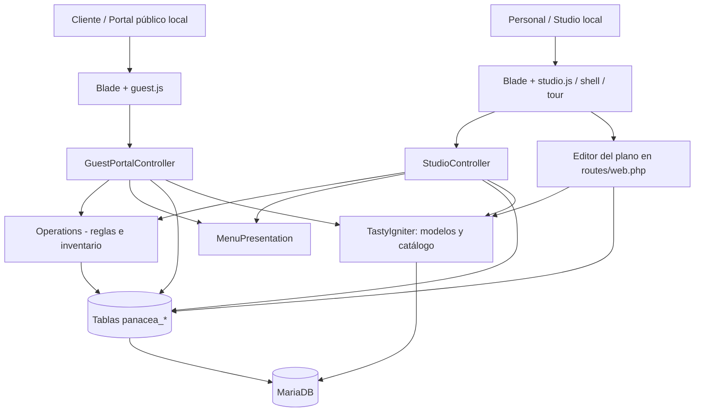
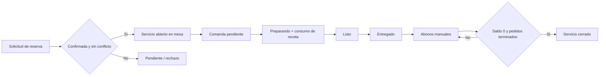

# 02 — Arquitectura técnica y stack

## Tecnologías verificadas en el repositorio

| Área | Dependencia/configuración | Evidencia |
| --- | --- | --- |
| Framework | Laravel `^13.0`, PHP `^8.3` | `composer.json` |
| Núcleo restaurant | `tastyigniter/core ^4.4`, TastyIgniter 4.x | `composer.json` |
| Entorno local | `php:8.3-apache`, Composer 2 | `docker/Dockerfile` |
| Persistencia | MariaDB `11.4` | `compose.panacea.yml` |
| HTTP | Apache con `rewrite` y `public/` como raíz | `docker/Dockerfile` |
| Construcción frontend base | Laravel Mix `^6.0.6`, npm, Axios `^0.25` | `package.json` |
| Frontend Panacea | Blade + HTML/CSS/JavaScript vanilla y SVG | `resources/views/panacea/`, `public/panacea/` |
| PHPUnit | `^12.5` | `composer.json` |
| Automatización | GitHub Actions y smoke tests `.mjs` | `.github/workflows/`, `tests/` |

No se identifica en el frontend Panacea una dependencia de React/Vue/Next.js. Los JS de Studio y del portal se sirven como recursos propios; no se requiere recompilarlos con Mix para cada ajuste.

## Arquitectura lógica

Flujo de red local: navegador → Apache en `127.0.0.1:8088` → rutas Laravel → controladores/servicios/modelos → MariaDB `db:3306`. `docker compose` mantiene `app` y `db` en la misma red virtual.

## Componentes propios

| Archivo | Responsabilidad |
| --- | --- |
| `routes/web.php` | Rutas HTTP, editor de plano local |
| `StudioController.php` | Snapshot de Studio, comandos de reserva/servicio/cocina/caja, diagnóstico |
| `GuestPortalController.php` | Carta del cliente y solicitud de reserva |
| `Operations.php` | Inventario, receta, consumo, incidencias, personal, clientes, auditoría, detección de conflictos |
| `MenuPresentation.php` | Anexar imágenes del catálogo nativo con tratamiento de errores |
| `studio.blade.php` | Estructura de pantallas del operador |
| `studio.js` | Estado Demo/Real, navegación, renderizado y acciones operativas |
| `studio-shell.js` | Menú lateral, persistencia de preferencias visuales |
| `studio-tour.js` | Guía no destructiva para grabar demos |
| `studio.css`, `studio-premium.css`, `studio-air.css`, `studio-night.css`, `studio-menu.css`, `studio-tour.css` | Capas de estilos del panel |
| `guest.blade.php`, `guest.js`, `guest.css`, `menu-imagery.js` | Sitio público local, carta visual y formulario |
| `database/migrations/2026_10_25_*` | Tablas Panacea e índices |

## Dos modos, una interfaz

**Demostración:** `studio.js` produce un escenario ficticio `demoSeed()`; los cambios se mantienen en memoria del navegador. Es ideal para grabaciones y pruebas visuales. No debe representarse como venta ni saldo reales.

**Datos reales:** `GET /panacea-preview/state` devuelve estructuras de MariaDB y los endpoints Panacea permiten escrituras locales validadas. El plano comparte la configuración de áreas y mesas de TastyIgniter; otros objetos (reservas, servicios, órdenes, existencias, pagos manuales) son **registros de Panacea separados**.

## Relación con TastyIgniter

- Se reutilizan `Igniter\Reservation\Models\DiningArea` y `DiningTable`; `seat_layout` almacena `id=group-<mesa>,x,y,rotation`.
- El catálogo se consulta de `menus` y el contenido fotográfico mediante `Igniter\Cart\Models\Menu` cuando existe adjunto.
- Se leen ciertas reservas nativas y asociaciones en forma conservadora.
- No se invocan ciclos de vida nativos completos para escritura de `orders`, `reservations`, `stocks` ni pagos. Esta frontera es una **deuda de integración explícita**.
- Evitar alterar `vendor/`; evolucionar mediante extensiones/servicios compatibles y pruebas de contrato.

## Flujo operativo resumido

## Decisiones arquitectónicas y limitaciones

- Interfaz monolítica Blade/JS adecuada a prototipo, con lógica visual centralizada en `studio.js`: conviene modularizar a medida que crezca.
- Las operaciones usan transacciones de MariaDB y bloqueos de fila en puntos críticos, pero **no están demostradas garantías de concurrencia integral** con TastyIgniter.
- Actualización periódica del estado desde navegador; **no hay websocket / realtime confirmado**.
- Imágenes ilustrativas remotas pueden depender de Internet y licencia/uso aplicable.
- El sitio `/experiencia` es una propuesta separada; no sustituye la portada nativa `/` ni se abre públicamente bajo `APP_ENV!=local`.
- Cualquier arquitectura de producción requiere autenticación, autorización por rol, auditoría atribuible, infraestructura y validaciones adicionales.
