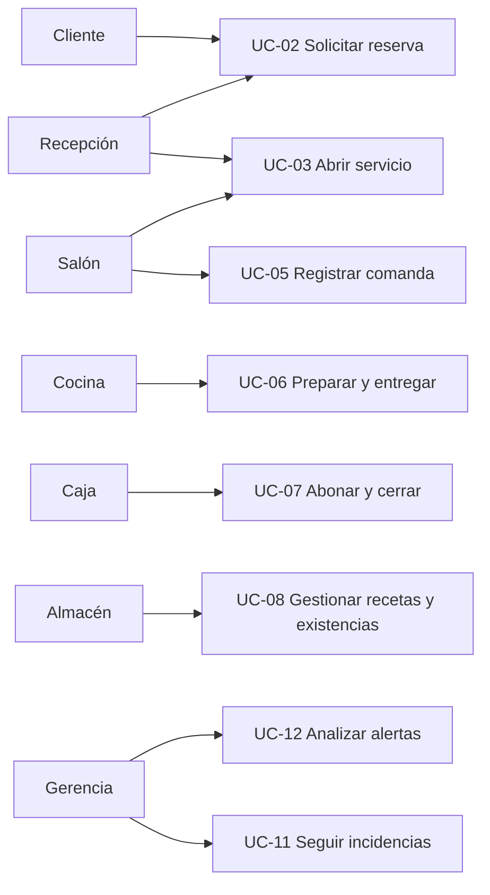

# 04 — Casos de uso del sistema

**Actores:** Cliente, Recepción, Salón, Cocina, Caja, Almacén, Gerencia y Administrador técnico. Son **roles de análisis**, no permisos efectivamente enforced por Panacea.  
**Estados:** `Implementado` (en el submodelo Panacea); `Parcial` (falta integración nativa); `Futuro` (no disponible).  
**Precondición general para operaciones internas:** aplicación en `APP_ENV=local`, base accesible y migraciones aplicadas.

## Vista general

## UC-01 — Consultar el centro de operaciones (Implementado)

**Actor:** personal del restaurante.  
**Pre:** Studio iniciado.  
**Flujo principal:** (1) Abrir `/panacea-preview`. (2) Elegir Demo o Datos reales. (3) Consultar KPIs y actividad. (4) Acceder a un módulo desde barra lateral.  
**Post:** solo cambió la vista/fuente seleccionada.  
**Alternos:** si falla la lectura de MariaDB, mostrar aviso; el escenario Demo sigue separado.  
**Requisitos:** RF-01, RF-02, RNF-13.

## UC-02 — Solicitar, confirmar y cancelar reserva (Parcial)

**Actores:** cliente y recepción.  
**Pre:** mesa nativa configurada, horario dentro de límite permitido, ninguna colisión conocida.  
**Flujo:** (1) Cliente abre `/experiencia`. (2) Indica nombre, correo, comensales y fecha y acepta el tratamiento de datos. (3) API valida la solicitud y escoge una mesa compatible. (4) Crea `panacea_service_reservations` con estado `pending`. (5) Recepción abre Reservas y confirma `pending→confirmed` si no hay conflicto.  
**Post:** solicitud creada y, solo tras revisión, confirmada en Panacea.  
**Alternos:** datos inválidos → 422; sin mesa/horario → 422; reserva antigua o duplicada → rechazo; cancelar `pending` o `confirmed` → `cancelled`.  
**Restricción:** NO envía email ni crea una reserva nativa confirmada.  
**Requisitos:** RF-05 a RF-08, RF-30 futura.

## UC-03 — Recibir cliente y abrir mesa (Implementado en Panacea)

**Actor:** recepción/salón.  
**Pre:** mesa con capacidad y sin sesión `open`; reserva compatible si existe.  
**Flujo:** (1) Abrir Salón y seleccionar mesa. (2) Recibir reserva confirmada o registrar walk-in sin conflicto. (3) Capturar nombre y grupo. (4) Vincular perfil opcionalmente. (5) Abrir `panacea_service_sessions.status=open`.  
**Post:** servicio activo, reserva asociada pasa a `seated`.  
**Alternos:** mesa ocupada, capacidad incompatible o reserva próxima → error sin apertura.  
**Requisitos:** RF-09, RF-10.

## UC-04 — Editar plano 2D (Implementado en entorno local)

**Actor:** responsable de sala.  
**Pre:** área y mesas nativas existentes.  
**Flujo:** (1) Salón → Editar plano. (2) Mover/rotar mesa, cambiar nombre, capacidad o forma. (3) Añadir pared/puerta/ventana/circulación. (4) Guardar.  
**Post:** cambios de mesas en formato nativo `seat_layout` y elementos en `panacea_floor_elements`.  
**Alternos:** mesa de otra área, duplicados o capacidad menor al mínimo → 422. Cancelar edición → no guardar.  
**Requisitos:** RF-03, RF-04.

## UC-05 — Registrar comanda de un servicio (Parcial)

**Actor:** salón.  
**Pre:** sesión Panacea `open` y producto de menú nativo válido.  
**Flujo:** (1) Seleccionar servicio. (2) Seleccionar productos y cantidades. (3) Servidor consulta el precio del catálogo, calcula subtotal y crea orden y líneas en Panacea.  
**Post:** comanda `pending` en vista Pedidos y Cocina.  
**Alternos:** sesión cerrada/producto inválido/cantidad fuera de rango → rechazo.  
**Restricción:** no crea automáticamente un registro `orders` nativo.  
**Requisitos:** RF-11.

## UC-06 — Preparar y entregar comanda (Implementado en Panacea)

**Actor:** cocina.  
**Pre:** comanda `pending`, `preparing` o `ready`.  
**Flujo:** (1) Cocina abre KDS. (2) Pendiente pasa a Preparando. (3) Si hay receta, el backend calcula consumo y valida stock. (4) Preparando pasa a Listo. (5) Listo pasa a Entregado.  
**Post:** comanda `served` y, cuando existe receta, movimientos de consumo en Panacea.  
**Alternos:** stock de receta insuficiente → no avanza ni descuenta; no permitir saltos o avance luego de `served`.  
**Requisitos:** RF-12, RF-17.

## UC-07 — Registrar abono y cerrar servicio (Parcial)

**Actor:** caja.  
**Pre:** servicio `open`, saldo pendiente conocido.  
**Flujo:** (1) Abrir Caja. (2) Seleccionar servicio. (3) Registrar monto y etiqueta del método manual. (4) Backend verifica saldo y clave idempotente. (5) Cuando saldo es cero y todas las órdenes están entregadas, cerrar servicio.  
**Post:** pago manual guardado, `panacea_service_sessions.status=closed`.  
**Alternos:** monto negativo/superior a deuda, intento duplicado, comanda no entregada → rechazar cierre.  
**Restricción:** no se procesan pagos de tarjeta ni se emite factura.  
**Requisitos:** RF-13, RF-14, RF-28 futura.

## UC-08 — Controlar inventario y receta (Implementado en subregistro propio)

**Actor:** almacén/cocina.  
**Pre:** migraciones de gerencia; producto de catálogo para receta.  
**Flujo:** (1) Crear ingrediente/unidad/costo/mínimo. (2) Registrar entrada. (3) Asociar cantidad por plato. (4) Al iniciar preparación de comanda, descontar existencia. (5) Revisar umbrales y costos consumidos.  
**Post:** movimiento `receive` o `consume`; no afecta stock nativo.  
**Alternos:** ingrediente inexistente/inactivo, cantidad inválida, saldo insuficiente → rechazo.  
**Requisitos:** RF-15 a RF-17.

## UC-09 — Crear perfil y contabilizar visita (Implementado básico)

**Actor:** atención.  
**Pre:** consentimiento declarado según formulario; cliente presente.  
**Flujo:** crear perfil opcional → seleccionar al abrir servicio → cerrar servicio → incrementar visitas del perfil.  
**Post:** historial de visitas sumado, sin adivinar identidad por nombre.  
**Alternos:** perfil no encontrado → rechazar asociación.  
**Requisitos:** RF-18, RF-19.

## UC-10 — Registrar integrante de equipo (Implementado básico)

**Actor:** administrador.  
**Flujo:** crear nombre, rol informativo y turno; consultar directorio.  
**Post:** fila en `panacea_staff_directory`.  
**Restricción:** no crea usuario/permiso nativo.  
**Requisitos:** RF-20.

## UC-11 — Gestionar incidencia (Implementado básico)

**Actor:** supervisor.  
**Flujo:** registrar título, prioridad y responsable opcional; revisar abiertas; resolver y registrar fecha.  
**Post:** incidencia `open→resolved` y evento de auditoría.  
**Alternos:** incidencia no existente o ya resuelta → error.  
**Requisitos:** RF-21.

## UC-12 — Consultar indicadores y alertas (Parcial)

**Actor:** gerencia.  
**Flujo:** abrir Gerencia → consultar comandas y abonos → revisar consumos e incidencias → elegir alerta y navegar al módulo.  
**Post:** orientación para la decisión, no acción automatizada.  
**Restricción:** no representa utilidad neta ni IA generativa.  
**Requisitos:** RF-22.

## UC-13 — Probar escenario de ingresos (Simulación)

**Actor:** gerencia.  
**Flujo:** ajustar precio, costo unitario variable, volumen y descuento → ver resultado proyectado.  
**Post:** no se escribe en la base de datos.  
**Requisitos:** RF-23.

## UC-14 — Explorar catálogo e imágenes (Implementado)

**Actor:** cliente o personal.  
**Flujo:** abrir carta → buscar nombre → revisar precio e imagen.  
**Alternos:** sin imagen real se usa visual ilustrativo identificado; sin productos se presenta estado vacío.  
**Requisitos:** RF-24.

## UC-15 — Presentar demo guiada (Implementado)

**Actor:** presentador/a.  
**Flujo:** icono ✳ discreto → elegir ruta exprés o completa → foco visual por módulo → avanzar manual o automáticamente.  
**Post:** solo cambia la navegación y el modo de demostración del navegador.  
**Alternos:** Esc cierra; editor de plano abierto impide iniciar.  
**Requisitos:** RF-25.

## Casos futuros no implementados

| Caso | Actor | Alcance para próxima versión |
| --- | --- | --- |
| UC-16 | Administrador | Roles, login, permisos efectivos, auditoría atribuible y baja de cuentas |
| UC-17 | Integrador técnico | Sincronización fiable de eventos y registros nativos TastyIgniter |
| UC-18 | Caja / Contabilidad | Pasarela, devoluciones, conciliación, factura e impuestos |
| UC-19 | Almacén / Compras | Proveedor, orden de compra, recepción por lote, merma y ajuste controlado |
| UC-20 | Cliente | Avisos de confirmación, cancelación y cambios de reserva |
| UC-21 | Gerencia | Multi-sucursal y partición de datos, configuraciones y permisos |

## Secuencia para demostración

`UC-01 → UC-14 → UC-02 → UC-03 → UC-05 → UC-06 → UC-07 → UC-08 → UC-12 → UC-15`.

En una demo comercial, etiquetar explícitamente qué ejemplo es ficticio y qué dato proviene de MariaDB.
