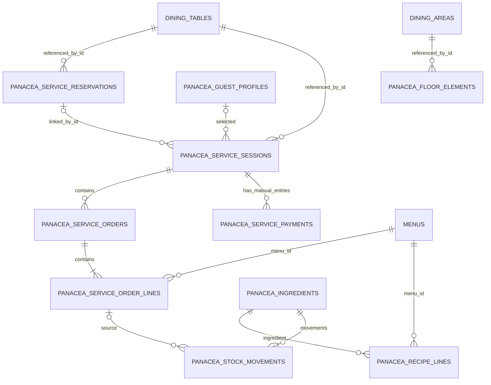

# 05 — Modelo de datos y persistencia

**Fuente:** migraciones `database/migrations/2026_10_25_*`, `StudioController`, `GuestPortalController` y `Operations`.  
**Motor local:** MariaDB 11.4. **El inventario y las transacciones Panacea no son el libro oficial de TastyIgniter.**

## Límites de propiedad de los datos

| Origen | Entidades | Política actual |
| --- | --- | --- |
| TastyIgniter nativo | `dining_areas`, `dining_tables`, `menus`, `reservations`, `reservation_tables`, `orders`, `stocks` (si existen) | Se leen; las propiedades/posiciones de mesa se modifican mediante el editor local. No escribir órdenes ni pagos nativos desde Panacea. |
| Panacea | `panacea_*` detalladas abajo | Se escriben localmente con transacciones y validación. |
| Demo en navegador | reservas, sesiones, pedidos, inventario, actividad ficticios | **No hay persistencia en MariaDB.** |
| Presentador | avance, spotlights, navegación visual | No crea registros operativos. |

## Entidades Panacea

| Tabla | Clave | Campos principales | Relaciones / limitaciones |
| --- | --- | --- | --- |
| `panacea_floor_elements` | `id` | `dining_area_id`, `kind`, `x,y,width,height,label` | Elementos por área; `kind`: `wall,door,window,aisle` |
| `panacea_service_reservations` | `id` | `dining_table_id`, `guest_name`, `party_size`, `reserved_at`, `duration_minutes`, `status`, `notes`, `contact_email`, `source` | Mesa nativa por ID; solicitud web `pending` |
| `panacea_service_sessions` | `id` | `dining_table_id`, `reservation_id`, `guest_profile_id`, `guest_name`, `party_size`, `status`, `opened_at`, `closed_at` | Una sesión Panacea `open` por mesa validada en controlador |
| `panacea_service_orders` | `id` | `session_id`, `status`, `subtotal` | Orden de sesión; estados de cocina |
| `panacea_service_order_lines` | `id` | `order_id`, `menu_id`, `title`, `quantity`, `unit_price` | Producto nativo referenciado por `menu_id`; precio copiado al pedir |
| `panacea_service_payments` | `id` | `session_id`, `amount`, `method`, `recorded_at`, `idempotency_key` | Abono **manual**, clave idempotente única; no transacción bancaria |
| `panacea_ingredients` | `id` | `name`, `unit`, `min_stock`, `unit_cost`, `active` | Catálogo propio de ingredientes |
| `panacea_recipe_lines` | `id` | `menu_id`, `ingredient_id`, `quantity` | Única `(menu_id, ingredient_id)`; FK física a ingrediente |
| `panacea_stock_movements` | `id` | `ingredient_id`, `kind`, `quantity_delta`, `unit_cost`, `order_line_id`, `note` | Movimiento `receive/consume`; única `(order_line_id,ingredient_id)`; FK a ingrediente |
| `panacea_guest_profiles` | `id` | `display_name`, `contact_opt_in`, `visits_count`, `last_visit_at` | Perfil opcional; no fusión automática con clientes nativos |
| `panacea_staff_directory` | `id` | `display_name`, `role`, `shift_label`, `active` | Directorio **no autoriza operaciones** |
| `panacea_incidents` | `id` | `title`, `severity`, `status`, `owner_label`, `dining_table_id`, `resolved_at` | Puede asociarse a mesa nativa por identificador |
| `panacea_audit_events` | `id` | `action`, `resource_type`, `resource_id`, `details`, `occurred_at` | Evento básico; **sin actor autenticado todavía** |

Todas las tablas creadas por las migraciones tienen `timestamps` excepto el registro de eventos de auditoría, que usa `occurred_at`. Los índices y FKs se definen en los archivos de migración; **no asumas FKs físicas** en campos que solo tienen `unsignedBigInteger` o `index()`.

## Relaciones lógicas

*Este ER describe vínculos **lógicos** para entender el dominio, no garantiza claves foráneas físicas ni cardinalidades impuestas por MariaDB en todos los casos.*

## Modelo de estados

- **Reserva:** solicitud `pending` → `confirmed` → `seated`. Alternativa: `pending|confirmed` → `cancelled`. Las reservas creadas internamente pueden entrar directamente como `confirmed`.
- **Sesión:** `open` → `closed`.
- **Comanda:** `pending` → `preparing` → `ready` → `served`.
- **Incidencia:** `open` → `resolved`.
- **Movimientos:** `receive` (delta positivo) / `consume` (delta negativo).

La mera lectura de asociaciones nativas **no permite inferir** el estado de ocupación de la mesa TastyIgniter.

## Cálculos implementados

1. **Existencia Panacea:** `stock = SUM(panacea_stock_movements.quantity_delta)` por ingrediente.
2. **Consumo de receta:** `cantidad por producto × cantidad pedida`, con precisión de milésimas. Se produce al empezar a preparar.
3. **Costo registrado de receta:** `Σ (-quantity_delta × unit_cost)` para movimientos `consume`; es un costo de consumo, **no utilidad neta**.
4. **Subtotal de comanda:** `Σ(quantity × precio del catálogo)` calculado en centavos por servidor y guardado como `subtotal`.
5. **Saldo de servicio:** total de comandas menos abonos manuales, sin impuestos/comisiones/facturación verificadas.

## Aspectos a completar antes de producción

- Definir claves foráneas y políticas de borrado que atraviesen Panacea/nativo sin romper extensiones.
- Hacer coincidir unidad de inventario, conversión, mermas, lotes y costos contables.
- Introducir identificación del usuario actor y esquema de autorización.
- Evitar lecturas/snapshot de datos personales sin autorización.
- Definir políticas de conservación de correos y datos del cliente.
- Implementar integración/transacciones nativas mediante contratos compatibles; establecer estrategia de migración y reconciliación.
- Probar transacciones concurrentes, cierres idempotentes y respaldos/restauración.

## Migraciones del proyecto

- `2026_10_25_000001`: plano y elementos de arquitectura.
- `2026_10_25_000002`: reserva, sesión, comanda, líneas y pagos manuales.
- `2026_10_25_000003`: ingredientes, recetas, movimientos, perfiles, personal, incidencias y auditoría.
- `2026_10_25_000004`: metadatos de solicitud del portal.
- `2026_10_25_000005`: clave de idempotencia de pagos.

Revisar el orden y ejecutar `php artisan migrate:status` antes de migrar en instalaciones que ya tienen datos.
