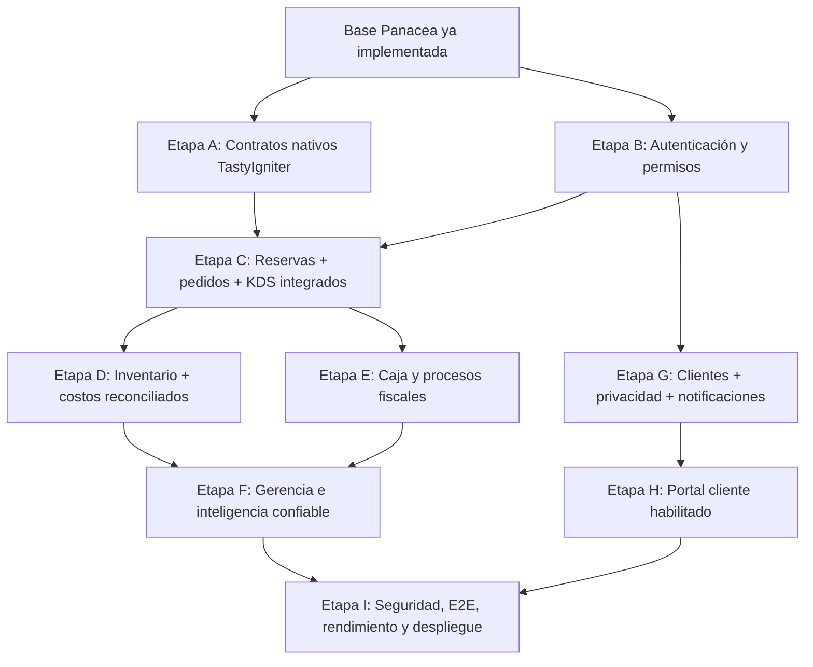

# 09 — Hoja de ruta y criterios de aceptación

> [!IMPORTANT]
> **Documento de referencia del MVP heredado.** La dirección aprobada para el siguiente desarrollo es **Panacea Core independiente**, sin TastyIgniter en runtime. No implementar nuevas integraciones nativas como destino final. Priorizar [ADR-001](architecture/ADR_001_CORE_INDEPENDIENTE.md) y el [plan standalone](architecture/PLAN_MIGRACION_CORE.md).

**Corte:** 2026-10-26. Esta hoja de ruta describe el trabajo restante; **no es un calendario comprometido** ni supone acceso a producción.

## Nivel de madurez

- **Base funcional local:** existe Studio, Demo/Real, migraciones, reservas Panacea, salón, comandas, cocina, caja manual y subinventario.
- **Producto operativo integrado:** **no alcanzado**. Faltan contratos del ciclo de vida nativo, acceso de personal seguro, concurrencia verificada y fiscalidad.
- **Producto comercial:** **no alcanzado**. Faltan operación real, políticas de privacidad, soporte, infraestructura y pruebas de aceptación.

## Dependencias por etapa

## Entregables y criterios de cierre

| Etapa | Entregable | Dependencias | Criterio de salida |
| --- | --- | --- | --- |
| A. Contratos nativos | Mapeo explícito `reservations/orders/stocks/payments` y extensiones TastyIgniter | Instalación estable y datos de prueba | Modelo de estados documentado y pruebas de contrato verdes |
| B. Identidad | Login y autorización por acción, rol y ubicación | Definir responsables y permisos | Pruebas de acceso permitido/prohibido y autor de auditoría |
| C. Servicio integrado | Reserva → sesión → orden → cocina con registro nativo consistente | A+B | Flujo extremo a extremo sin doble ocupación ni estado divergente |
| D. Inventario | Consumo y conciliación de recetas, costos, entradas y mermas | C | Movimientos verificables, costo trazable y pruebas de stock negativo |
| E. Caja/fiscal | Medios reales autorizados, devolución/conciliación, impuestos y comprobantes | B+C y requisitos legales | Pruebas bancarias/fiscales, políticas y reconciliación aprobadas |
| F. Dirección | Tableros de márgenes, tendencias y recomendaciones con fuentes | D+E | Métricas explicadas, cobertura de costos y comparaciones reproducibles |
| G. CRM y personal | Consentimiento, retención, permisos, turnos y registro de cambios | B | Evaluación de privacidad y trazabilidad por persona |
| H. Portal cliente | Reservas completas con notificación, disponibilidad verificada | C+G | Confirmación/actualización/cancelación coherentes con operación |
| I. Producción | Copias, monitoreo, CI E2E, pruebas carga/seguridad, runbook | Todas | Go/no-go formal y restauración ensayada |

## Backlog sugerido por prioridad

### P0 — Imprescindible antes de usar con clientes reales
- Identidad, políticas de autorización y protección de todas las rutas de escritura.
- Resolver duplicidad de estados entre Panacea y entidades TastyIgniter.
- Prueba real de concurrencia de reservas, servicios, cierre y pagos.
- Tratamiento de datos personales, política de privacidad, conservación y consentimiento.
- Backups y restauración ensayada.
- Distinguir pagos manuales de cobros efectivamente procesados, y garantizar el cumplimiento fiscal.

### P1 — Operación y gestión robustas
- Mapeo de estaciones y temporizadores KDS, modificadores y alérgenos.
- Transacciones e idempotencia completas en cada acción de negocio.
- Proveedores, compras, lotes, caducidad, mermas, recetas más complejas y ajuste auditable.
- Notificaciones a clientes de recepción/confirmación/cancelación.
- Panel de gerencia con métricas verificadas (no confundir abonos con venta reconocida).
- Filtros por fechas, auditoría de cambios y seguimiento de incidencias.

### P2 — Diferenciación comercial
- Motor de promociones y fidelización con consentimiento.
- Experiencia pública multicanal.
- Integración de IA cuando exista calidad de datos y evidencia para las recomendaciones.
- Multi-sucursal, operación con conectividad limitada, analítica avanzada.
- Temas visuales y branding por negocio, sin sacrificar accesibilidad.

## Matriz de fases frente al prototipo

| Línea | Ya disponible | Falta sustancial |
| --- | --- | --- |
| Salón | Plano editable, ficha, mesa por ID nativo | Reconciliar ocupación nativa, mesas combinadas/lista espera, permisos |
| Reservas | Solicitudes pendientes y confirmación, controles de choque | Ciclo nativo, avisos, estados completos |
| Pedidos/KDS | Comanda Panacea, 4 estados | Sincronización nativa, modificadores y estaciones |
| Caja | Abono manual, saldo, cierre | Pasarela, fiscalidad, devoluciones, conciliación |
| Inventario | Ingredientes, receta, movimiento y costo simple | Compras, lotes, mermas, stock nativo |
| Clientes/Equipo | Directorios y visita ligada | Permisos, datos completos y políticas |
| Gerencia | Reglas de alerta y métricas parciales | Modelo financiero real, costes generales, IA documentada |
| Cliente | Portada, menú y solicitud | Confirmación comunicada, seguridad pública y disponibilidad nativa |
| UI | Pantallas, temas, menú lateral, microanimación y tutorial | Auditoría visual responsive/E2E y optimización |

## Medición propuesta antes de cierre

Cada módulo debería tener: dueño responsable, definición de terminado, entradas y salidas API, casos negativos, prueba automática, prueba en Docker, evidencia visual y riesgos pendientes. Sin evidencia, conservar estado **parcial**.

## Política documental

Actualizar [requisitos](03_REQUISITOS_Y_REGLAS.md) y [casos de uso](04_CASOS_DE_USO.md) al concluir un módulo, [modelo de datos](05_MODELO_DE_DATOS.md) con migraciones, [API](06_API_Y_FLUJOS.md) con endpoints y [seguridad](08_CALIDAD_SEGURIDAD_Y_RIESGOS.md) tras pruebas. No usar documentos históricos para afirmar que una función actual es solo simulada o ya está totalmente integrada.
